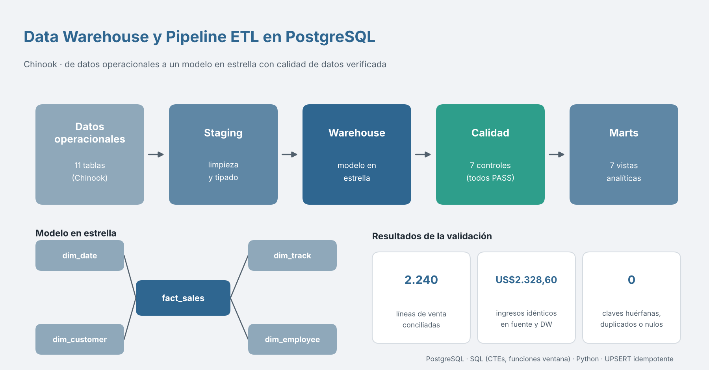
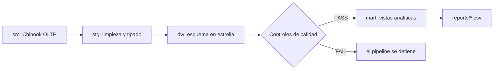

# Data Warehouse SQL + ETL con Chinook (PostgreSQL)

Pipeline de datos de punta a punta: datos operacionales → **staging** → **data warehouse en estrella** → **controles de calidad** → **marts analíticos** → reportes CSV. Todo en SQL puro (PostgreSQL 16), orquestado por un script Python que solo usa la librería estándar y `psql`.

🇬🇧 English version: [README.md](README.md)



## Arquitectura



Granularidad de `fact_sales`: **una fila por línea de factura**. Dimensiones: fecha, cliente, canción/artista/género y ejecutivo de soporte.

## Qué demuestra

- **Limpieza y estandarización** de datos (`sql/01_staging.sql`).
- **Modelado dimensional** con claves, restricciones e índices (`sql/02_dw_schema.sql`).
- **Cargas idempotentes** con `INSERT … ON CONFLICT` (`sql/03_load_dw.sql`).
- **Calidad de datos**: conciliación de filas e ingresos, claves huérfanas, duplicados y nulos (`sql/04_data_quality.sql`).
- **SQL analítico**: funciones ventana (LAG, NTILE, acumulados, medias móviles), cohortes y Pareto (`sql/05_marts.sql`).
- **Orquestación** con registro de ejecución y detención ante fallos de calidad (`etl/run_pipeline.py`).

## Resultados

Los 7 controles de calidad pasan: 2.240 líneas y $2.328,60 de ingresos concilian entre fuente y DW. Los marts se exportan a `reports/`: ingresos mensuales (MoM, YoY, media móvil), segmentación RFM de clientes, ingresos por género, Pareto de artistas, retención por cohorte, desempeño por ejecutivo e ingresos por país.

## Cómo ejecutar

```bash
createdb chinook_dw
psql -d chinook_dw -c "CREATE SCHEMA src"
PGOPTIONS='-c search_path=src' psql -d chinook_dw -f Chinook_PostgreSql_SerialPKs.sql
python3 etl/run_pipeline.py --db chinook_dw
```

El pipeline se puede re-ejecutar sin duplicar datos.

## Stack
PostgreSQL 16 · SQL (CTEs, funciones ventana) · Python 3 (stdlib) · Mermaid

## Dataset
[Chinook](https://github.com/lerocha/chinook-database): base pública de ejemplo de una tienda de música digital (59 clientes, 412 facturas).
