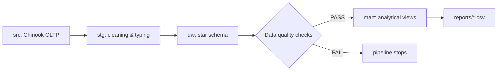
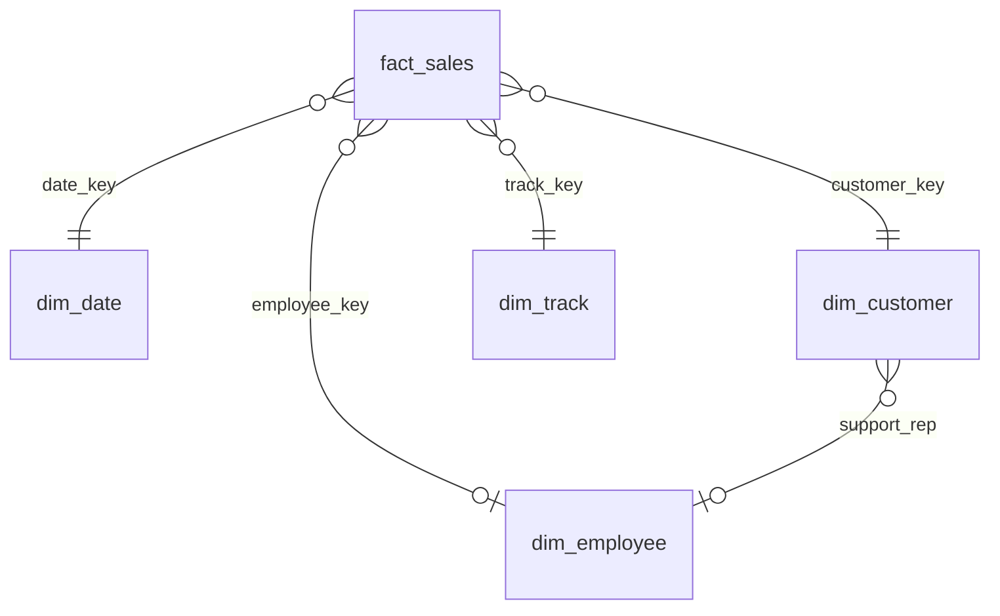

# Chinook SQL + ETL Data Warehouse (PostgreSQL)

End-to-end data pipeline: raw operational data → **staging** → **star-schema data warehouse** → **data-quality checks** → **analytical marts** → CSV reports. Everything is plain SQL (PostgreSQL 16) orchestrated by a small Python script that only needs the standard library and `psql`.

🇪🇸 Versión en español: [README.es.md](README.es.md)

## Architecture





Grain of `fact_sales`: **one row per invoice line**.

## What it demonstrates

| Skill | Where |
|---|---|
| Data cleaning / standardisation (INITCAP, COALESCE, typing) | `sql/01_staging.sql` |
| Dimensional modelling, keys, constraints, indexes | `sql/02_dw_schema.sql` |
| Idempotent loads with `INSERT … ON CONFLICT` (UPSERT) | `sql/03_load_dw.sql` |
| Data quality: reconciliation, orphan keys, duplicates, nulls | `sql/04_data_quality.sql` |
| Window functions (LAG, NTILE, running totals, moving averages), cohorts, Pareto | `sql/05_marts.sql` |
| Orchestration, logging, fail-fast on quality errors | `etl/run_pipeline.py` |

## Data quality checks (all PASS)

Row reconciliation (2,240 lines source = DW) · revenue reconciliation (2,328.60 source = DW) · no orphan facts · consistent amounts · unique natural keys · no nulls in required fields · all dates covered by `dim_date`.

## Analytical marts

`v_monthly_revenue` (MoM, YoY, 3-month moving average, YTD) · `v_customer_rfm` (NTILE quintiles + segments) · `v_genre_revenue` · `v_artist_pareto` · `v_cohort_retention` · `v_rep_performance` · `v_country_revenue`. Exported to `reports/`.

## How to run

```bash
# 1. Load the public Chinook dataset into schema "src" of a database (PostgreSQL version)
#    https://github.com/lerocha/chinook-database  (Chinook_PostgreSql_SerialPKs.sql)
createdb chinook_dw
psql -d chinook_dw -c "CREATE SCHEMA src"
PGOPTIONS='-c search_path=src' psql -d chinook_dw -f Chinook_PostgreSql_SerialPKs.sql

# 2. Run the whole pipeline
python3 etl/run_pipeline.py --db chinook_dw
```

The pipeline is re-runnable: staging is rebuilt and the warehouse is upserted, so repeated runs do not duplicate data.

## Stack
PostgreSQL 16 · SQL (CTEs, window functions) · Python 3 (stdlib) · Mermaid

## Dataset
[Chinook](https://github.com/lerocha/chinook-database), a public sample database of a digital music store (59 customers, 412 invoices).
